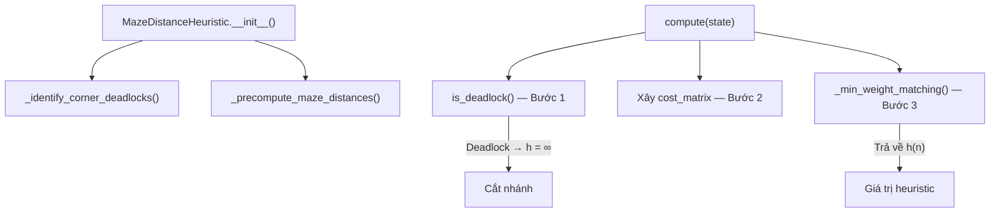
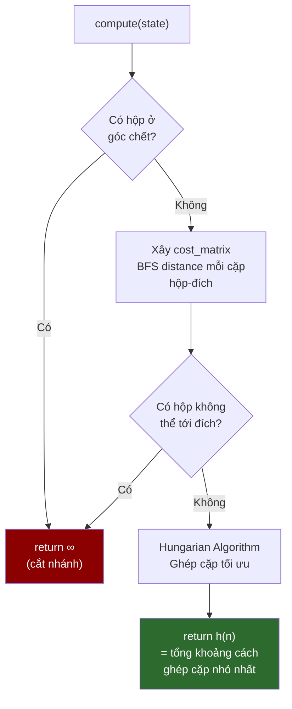

# Giải thích chi tiết: heuristics.py

File [`heuristics.py`](file:///e:/baitap/AI/MidTerm/heuristics.py) chứa **hàm heuristic** — bộ phận quan trọng nhất giúp A* nhanh hơn UCS. Nó trả lời câu hỏi: **"Từ trạng thái hiện tại, ít nhất cần bao nhiêu bước nữa để giải xong?"**

---

## Tổng quan cấu trúc



---

## Phần 1: Import và khai báo class (Dòng 1-16)

```python
# Dòng 1-5: Comment giải thích lý thuyết
# - Admissible: h(n) <= h*(n) — không bao giờ ước lượng QUÁ chi phí thực
# - Consistent: h(n) <= c(n,a,n') + h(n') — thỏa bất đẳng thức tam giác
# - Deadlock: hộp kẹt góc → h = vô cùng

from collections import deque       # Dòng 7: Hàng đợi hai đầu, dùng cho BFS
from typing import Dict, Tuple, Set, List  # Dòng 8: Type hints
from state import SokobanMap, SokobanState # Dòng 9: Import class bản đồ và trạng thái
```

> [!NOTE]
> **Tại sao dùng `deque` thay vì `list`?**
> - `deque.popleft()` = O(1) — lấy phần tử đầu rất nhanh
> - `list.pop(0)` = O(n) — phải dịch toàn bộ phần tử
> - BFS cần lấy phần tử đầu hàng triệu lần → `deque` nhanh hơn nhiều

```python
class MazeDistanceHeuristic:           # Dòng 12
    """
    Tính heuristic dựa trên BFS Maze Distance kết hợp thuật toán gán cặp tối ưu.
    """
```

---

## Phần 2: Khởi tạo `__init__` (Dòng 17-21)

```python
def __init__(self, map_data: SokobanMap):
    self.map = map_data                                    # Lưu bản đồ
    self.deadlocks = self._identify_corner_deadlocks()     # Bước 1: tìm ô chết
    self.dist_to_goal: Dict[Tuple[int,int], Dict[Tuple[int,int], int]] = {}
    self._precompute_maze_distances()                      # Bước 2: tính BFS distance
```

**Khi tạo object `MazeDistanceHeuristic(map)`, 2 việc được làm ngay lập tức:**

1. **Tìm tất cả ô deadlock** trên bản đồ (chỉ làm 1 lần)
2. **Tính trước khoảng cách BFS** từ mọi ô đến mọi đích (chỉ làm 1 lần)

**Cấu trúc `dist_to_goal`:**
```
dist_to_goal = {
    (1,3): {            ← goal ở vị trí (1,3)
        (1,3): 0,       ← khoảng cách từ (1,3) đến chính nó = 0
        (1,2): 1,       ← khoảng cách từ (1,2) đến goal (1,3) = 1
        (2,3): 1,       ← khoảng cách từ (2,3) đến goal (1,3) = 1
        (2,2): 2,       ← khoảng cách từ (2,2) đến goal (1,3) = 2
        ...
    },
    (5,3): {            ← goal ở vị trí (5,3)
        (5,3): 0,
        (4,3): 1,
        ...
    }
}
```

→ Sau đó, tra cứu khoảng cách chỉ mất **O(1)** (dict lookup).

---

## Phần 3: Phát hiện Deadlock `_identify_corner_deadlocks` (Dòng 23-49)

### Deadlock là gì?

Trong Sokoban, agent chỉ có thể **đẩy** hộp, không thể **kéo**. Nếu hộp bị đẩy vào một **góc tường** mà góc đó **không phải đích**, thì hộp sẽ **mãi mãi kẹt** ở đó — bài toán vô nghiệm.

```
Ví dụ Deadlock:

  %%                %%               %                %
  %B  ← kẹt!      B%  ← kẹt!     %B  ← kẹt!     B%  ← kẹt!
                                    %%               %%

  Trên+Trái        Trên+Phải      Dưới+Trái       Dưới+Phải
```

### Code chi tiết:

```python
def _identify_corner_deadlocks(self) -> Set[Tuple[int, int]]:
    deadlocks = set()                          # Tập hợp các ô chết
    for r in range(self.map.rows):             # Duyệt từng hàng
        for c in range(self.map.cols):         # Duyệt từng cột
            pos = (r, c)
```

**Dòng 33-34 — Lọc bỏ các ô không cần xét:**
```python
            if self.map.is_wall(r, c) or pos in self.map.goals:
                continue
```
- Ô tường → hộp không thể ở đây → bỏ qua
- Ô đích → dù kẹt góc thì hộp vẫn ở đúng vị trí → **không phải deadlock** → bỏ qua

**Dòng 37-40 — Kiểm tra 4 hướng xung quanh:**
```python
            up_wall    = self.map.is_wall(r - 1, c)   # Phía trên có tường?
            down_wall  = self.map.is_wall(r + 1, c)   # Phía dưới có tường?
            left_wall  = self.map.is_wall(r, c - 1)   # Bên trái có tường?
            right_wall = self.map.is_wall(r, c + 1)   # Bên phải có tường?
```

**Dòng 43-47 — Kiểm tra 4 tổ hợp góc vuông:**
```python
            if (up_wall and left_wall) or \     # Góc trên-trái
               (up_wall and right_wall) or \    # Góc trên-phải
               (down_wall and left_wall) or \   # Góc dưới-trái
               (down_wall and right_wall):      # Góc dưới-phải
                deadlocks.add(pos)              # → Đánh dấu là deadlock
```

### Ví dụ cụ thể trên bản đồ:

```
%%%%%%%       Kiểm tra ô (1,1):
% A   %         Trên: (0,1) = % → True
% %%  %         Trái: (1,0) = % → True
%   B %         → up_wall AND left_wall → DEADLOCK!
%   D %
%%%%%%%       Kiểm tra ô (1,5):
                Trên: (0,5) = % → True
                Phải: (1,6) = % → True
                → up_wall AND right_wall → DEADLOCK!

              Kiểm tra ô (4,4) = D (đích):
                → pos in self.map.goals → BỎ QUA (không phải deadlock)
```

---

## Phần 4: Tiền xử lý BFS Distance `_precompute_maze_distances` (Dòng 51-74)

### Tại sao dùng BFS thay vì Manhattan Distance?

**Đề bài cấm dùng Manhattan và Euclidean.** Nhưng ngay cả nếu không cấm, BFS distance cũng chính xác hơn:

```
Manhattan distance = |r1-r2| + |c1-c2| = 2 (đi xuyên tường!)

  %%%%%
  %B%%D%     Manhattan: |1-1| + |1-3| = 2
  %   %%     Nhưng thực tế phải đi vòng: B→(2,1)→(2,2)→(2,3)→(1,3) = 4
  %%%%%
  
BFS distance = 4 (đi vòng tránh tường) ← CHÍNH XÁC!
```

### Code chi tiết:

```python
def _precompute_maze_distances(self):
    directions = [(-1, 0), (1, 0), (0, -1), (0, 1)]   # Bắc, Nam, Tây, Đông
```

**Dòng 58-74 — BFS ngược từ mỗi đích:**

```python
    for goal in self.map.goals:                    # Với MỖI đích D
        dist_map: Dict[...] = {goal: 0}           # Khoảng cách từ đích đến chính nó = 0
        queue = deque([goal])                      # BFS bắt đầu từ đích
```

> [!IMPORTANT]
> **BFS chạy NGƯỢC — từ đích ra ngoài**, không phải từ hộp đến đích. Lý do: chỉ cần chạy BFS **1 lần từ mỗi đích** là biết khoảng cách từ **MỌI ô** đến đích đó. Nếu chạy từ mỗi hộp → phải chạy lại mỗi khi hộp di chuyển.

```python
        while queue:                               # Lặp cho đến khi hết ô để duyệt
            curr_r, curr_c = queue.popleft()       # Lấy ô đầu hàng đợi
            curr_d = dist_map[(curr_r, curr_c)]    # Khoảng cách hiện tại

            for dr, dc in directions:              # Thử 4 hướng
                nr, nc = curr_r + dr, curr_c + dc  # Ô kế tiếp
                next_pos = (nr, nc)

                # Nếu ô kế không phải tường VÀ chưa được duyệt
                if not self.map.is_wall(nr, nc) and next_pos not in dist_map:
                    dist_map[next_pos] = curr_d + 1  # Khoảng cách = cha + 1
                    queue.append(next_pos)           # Đưa vào hàng đợi

        self.dist_to_goal[goal] = dist_map         # Lưu kết quả BFS cho đích này
```

### Minh họa BFS từ đích D=(4,4):

```
Bước 0: Bắt đầu từ D         Bước 1: Lan ra 1 bước       Bước 2: Lan ra 2 bước
%%%%%%%                        %%%%%%%                      %%%%%%%
%     %                        %     %                      %     %
% %%  %                        % %%  %                      % %%2 %
%     %                        %  1  %                      % 212 %
%   D %                        %  10 %                      %3210 %
%%%%%%%                        %%%%%%%                      %%%%%%%

→ dist_map = {(4,4):0, (3,4):1, (4,3):1, (2,4):2, (3,3):2, (3,5):2, ...}
```

---

## Phần 5: Tra cứu khoảng cách `get_maze_dist` (Dòng 76-78)

```python
def get_maze_dist(self, pos: Tuple[int, int], goal: Tuple[int, int]) -> int:
    return self.dist_to_goal.get(goal, {}).get(pos, 999999)
```

- `self.dist_to_goal.get(goal, {})` → lấy bảng khoảng cách của đích `goal`. Nếu đích không tồn tại → trả `{}`
- `.get(pos, 999999)` → lấy khoảng cách từ `pos`. Nếu `pos` không thể đến đích (bị tường bao kín) → trả `999999` (coi như vô cực)

---

## Phần 6: Kiểm tra Deadlock `is_deadlock` (Dòng 80-85)

```python
def is_deadlock(self, boxes: Set[Tuple[int, int]]) -> bool:
    for box in boxes:               # Duyệt từng hộp
        if box in self.deadlocks:   # Hộp này nằm ở góc chết?
            return True             # → CÓ deadlock → trạng thái này vô nghiệm
    return False                    # Không hộp nào ở góc chết → OK
```

---

## Phần 7: Tính h(n) chính `compute` (Dòng 87-114)

Đây là hàm được A* gọi mỗi khi sinh ra trạng thái mới.

### Bước 1 — Phát hiện Deadlock (Dòng 92-94):

```python
if self.is_deadlock(state.boxes):
    return float("inf")           # h = ∞ → A* sẽ KHÔNG BAO GIỜ mở rộng nhánh này
```

> [!TIP]
> Đây là tối ưu quan trọng nhất! Cắt bỏ hàng ngàn trạng thái vô nghiệm ngay từ đầu.

### Bước 2 — Xây dựng Cost Matrix (Dòng 96-110):

```python
boxes = list(state.boxes)        # Danh sách vị trí hộp hiện tại
goals = list(self.map.goals)     # Danh sách vị trí đích

n = len(boxes)                   # Số hộp
m = len(goals)                   # Số đích

# Ma trận chi phí: cost_matrix[i][j] = khoảng cách BFS từ hộp i đến đích j
cost_matrix = [[self.get_maze_dist(box, goal) for goal in goals] for box in boxes]
```

**Ví dụ:** 2 hộp B1=(2,2), B2=(4,3) và 2 đích D1=(1,3), D2=(5,3)

```
              D1=(1,3)    D2=(5,3)
B1=(2,2)        2            5        ← BFS distance
B2=(4,3)        4            2

cost_matrix = [[2, 5],
               [4, 2]]
```

**Dòng 108-110 — Kiểm tra hộp không thể tới đích nào:**
```python
for r in range(n):
    if all(cost_matrix[r][c] >= 999999 for c in range(m)):  # Hộp r cách MỌI đích = ∞
        return float("inf")                                  # → Vô nghiệm
```

### Bước 3 — Giải bài toán ghép cặp tối ưu (Dòng 112-114):

```python
total_dist = self._min_weight_matching(cost_matrix, n, m)
return float(total_dist)      # h(n) = tổng khoảng cách ghép cặp nhỏ nhất
```

### Tại sao cần ghép cặp tối ưu mà không chỉ lấy khoảng cách gần nhất?

```
Trường hợp sai nếu mỗi hộp chọn đích gần nhất:

              D1      D2
B1            1       10        B1 chọn D1 (gần nhất) → 1
B2            2       10        B2 cũng chọn D1 (gần nhất) → 2
                                NHƯNG 2 hộp không thể vào cùng 1 đích!

Cách đúng (Hungarian Algorithm):
  Ghép B1→D1 (1) + B2→D2 (10) = 11
  Ghép B1→D2 (10) + B2→D1 (2) = 12
  → Tối ưu: B1→D1, B2→D2 = 11 ✓
```

---

## Phần 8: Thuật toán Hungarian `_min_weight_matching` (Dòng 116-173)

Đây là phần phức tạp nhất. Thuật toán Hungarian (Kuhn-Munkres) giải **bài toán gán cặp cực tiểu** trong O(n³).

### Bài toán: 
Cho `n` hộp và `m` đích (n ≤ m), mỗi cặp (hộp i, đích j) có chi phí `cost[i][j]`. Tìm cách ghép mỗi hộp với **đúng 1 đích riêng biệt** sao cho **tổng chi phí nhỏ nhất**.

### Ý tưởng thuật toán:

Thuật toán dùng khái niệm **dual variables** (biến đối ngẫu) `u[i]` và `v[j]`:
- `u[i]` = "tiềm năng" của hộp `i`
- `v[j]` = "tiềm năng" của đích `j`
- Luôn duy trì: `u[i] + v[j] ≤ cost[i][j]` (điều kiện đối ngẫu)
- Khi tìm được ghép cặp mà `u[i] + v[j] = cost[i][j]` cho mọi cặp → **tối ưu!**

### Code từng bước:

**Dòng 121-130 — Chuẩn bị ma trận (1-indexed):**
```python
if n == 0 or m == 0:
    return 0                           # Không có hộp hoặc đích → h = 0

k = max(n, m)                          # Kích thước ma trận vuông
cost = [[0] * (k + 1) for _ in range(k + 1)]  # Ma trận (k+1) × (k+1), 1-indexed
for i in range(n):
    for j in range(m):
        cost[i + 1][j + 1] = cost_matrix[i][j]  # Copy vào vị trí 1-indexed
```

> [!NOTE]
> Ma trận dùng **1-indexed** (bỏ hàng 0, cột 0) để code Hungarian gọn hơn. Hàng/cột thừa có cost = 0 (hộp ảo, không ảnh hưởng kết quả).

**Dòng 133-136 — Khởi tạo biến:**
```python
u = [0] * (k + 1)       # Tiềm năng hàng (potential) — cho mỗi hộp
v = [0] * (k + 1)       # Tiềm năng cột (potential) — cho mỗi đích
p = [0] * (k + 1)       # p[j] = hộp nào đang ghép với đích j (0 = chưa ghép)
way = [0] * (k + 1)     # way[j] = đích trước j trong đường tăng (augmenting path)
```

**Dòng 138-171 — Vòng lặp chính (duyệt từng hộp):**

```python
for i in range(1, n + 1):        # Xét hộp thứ i
    p[0] = i                     # Gán hộp i vào "đích ảo 0" (điểm bắt đầu)
    j0 = 0                       # Bắt đầu từ đích ảo 0
    minv = [float("inf")] * (k + 1)  # minv[j] = giá trị "reduced cost" nhỏ nhất cho đích j
    used = [False] * (k + 1)         # used[j] = đích j đã nằm trong cây chưa?
```

**Vòng while bên trong — Tìm đường tăng (augmenting path):**

```python
    while True:
        used[j0] = True           # Đánh dấu đích j0 đã dùng
        i0 = p[j0]                # Hộp đang ghép với đích j0
        delta = float("inf")     # delta = giá trị điều chỉnh tiềm năng nhỏ nhất
        j1 = 0                    # j1 = đích tiếp theo tốt nhất

        for j in range(1, m + 1):           # Duyệt tất cả đích chưa dùng
            if not used[j]:
                cur = cost[i0][j] - u[i0] - v[j]   # "Reduced cost" = cost thực - tiềm năng
                if cur < minv[j]:
                    minv[j] = cur            # Cập nhật reduced cost nhỏ nhất cho đích j
                    way[j] = j0              # Ghi nhớ "đích trước" để truy vết
                if minv[j] < delta:
                    delta = minv[j]          # Tìm delta nhỏ nhất
                    j1 = j                   # Đích tốt nhất tiếp theo
```

**Cập nhật tiềm năng:**
```python
        for j in range(k + 1):
            if used[j]:
                u[p[j]] += delta     # Tăng tiềm năng hộp trong cây
                v[j] -= delta        # Giảm tiềm năng đích trong cây
            else:
                minv[j] -= delta     # Cập nhật reduced cost cho đích ngoài cây
```

> [!IMPORTANT]
> Bước cập nhật này đảm bảo tính chất `u[i] + v[j] ≤ cost[i][j]` luôn được giữ, đồng thời "mở rộng" tập hợp các cạnh có reduced cost = 0 (tight edges).

**Kiểm tra kết thúc:**
```python
        j0 = j1                      # Di chuyển sang đích tốt nhất
        if p[j0] == 0:               # Đích j0 chưa ghép với hộp nào?
            break                    # → Tìm thấy đường tăng! Dừng.
```

**Truy vết và cập nhật ghép cặp:**
```python
    while True:
        j1 = way[j0]                 # Đích trước j0 trên đường tăng
        p[j0] = p[j1]               # Chuyển ghép: hộp của j1 → j0
        j0 = j1                     # Lùi lại
        if j0 == 0:                 # Về đến đích ảo 0?
            break                   # → Xong!
```

**Dòng 173 — Trả về kết quả:**
```python
    return -v[0]    # Tổng chi phí tối ưu = -v[0] (tính chất đối ngẫu)
```

> [!NOTE]
> **Tại sao `return -v[0]`?** Trong thuật toán Hungarian, `v[0]` là tiềm năng của "đích ảo 0". Theo lý thuyết đối ngẫu, giá trị nghiệm tối ưu = `-v[0]`. Đây là kết quả toán học đã được chứng minh.

---

## Ví dụ chạy hoàn chỉnh

Cho trạng thái: 2 hộp B1=(2,2), B2=(4,3) và 2 đích D1=(1,3), D2=(5,3)

```
Bước 1: is_deadlock? → (2,2) không ở góc chết, (4,3) không ở góc chết → FALSE

Bước 2: Cost matrix:
         D1    D2
  B1  [  2  ,  5  ]     ← BFS distance
  B2  [  4  ,  2  ]

Bước 3: Hungarian Algorithm:
  Ghép B1→D1 (cost=2), B2→D2 (cost=2)  → tổng = 4
  Ghép B1→D2 (cost=5), B2→D1 (cost=4)  → tổng = 9
  → Tối ưu: 4

→ h(n) = 4.0
```

Nghĩa là: **ít nhất cần 4 bước nữa** (ước lượng) để đưa tất cả hộp vào đích. A* dùng giá trị này để ưu tiên các trạng thái gần đích hơn.

---

## Tại sao Heuristic này Admissible và Consistent?

### Admissible (h(n) ≤ h*(n)):

1. BFS distance cho khoảng cách **ngắn nhất có thể** trên mê cung
2. Trong thực tế, hộp cần agent đẩy → đường đi thực tế **≥** BFS distance
3. Hungarian cho ghép cặp tối ưu → tổng khoảng cách **nhỏ nhất có thể**
4. → h(n) ≤ chi phí thực tế h*(n) ✓

### Consistent (h(n) ≤ c(n,a,n') + h(n')):

Khi agent đi 1 bước (cost = 1):
- Nếu không đẩy hộp: vị trí hộp không đổi → h giảm tối đa 0 → h(n) - h(n') ≤ 0 ≤ 1 ✓
- Nếu đẩy hộp: 1 hộp di chuyển 1 ô → khoảng cách BFS thay đổi tối đa 1 → h(n) - h(n') ≤ 1 = c ✓

---

## Tóm tắt


