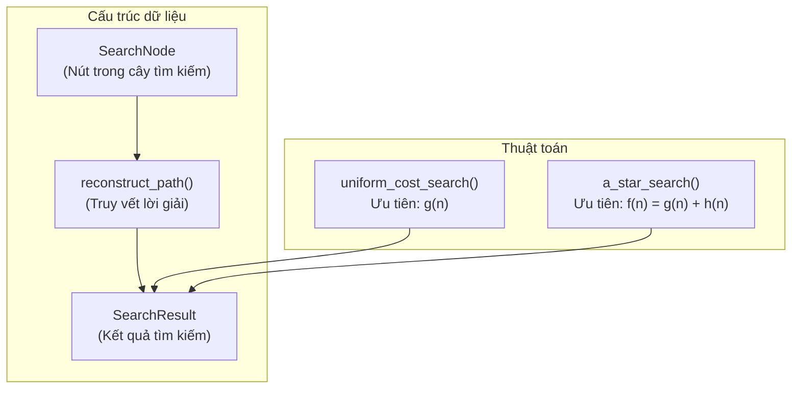
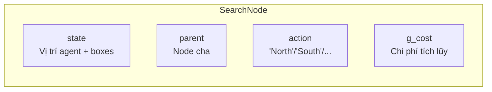
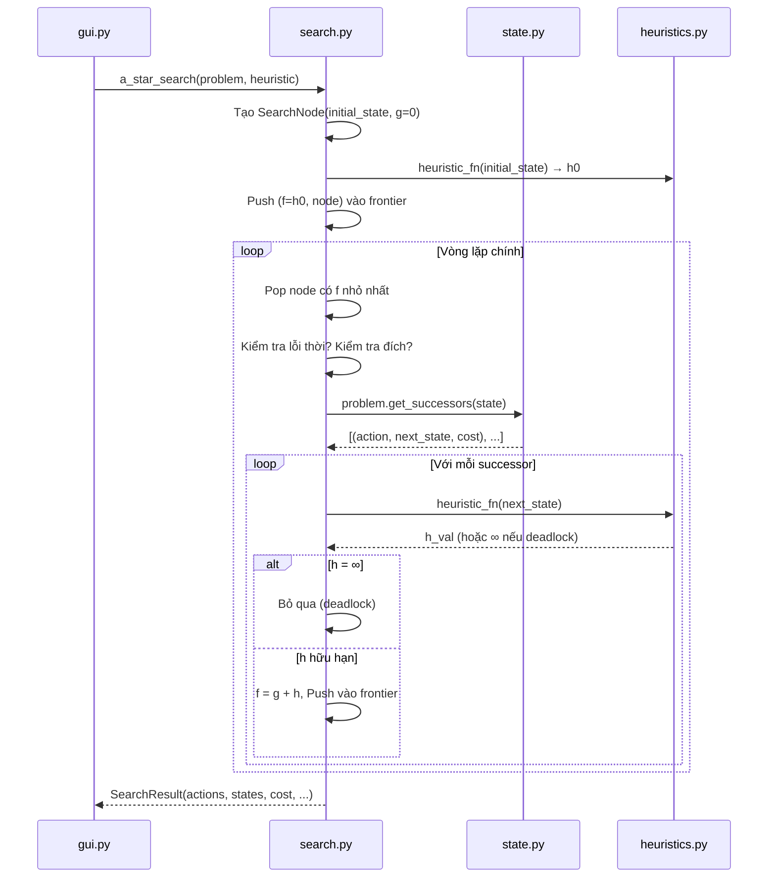

# Giải thích chi tiết: search.py

File [`search.py`](file:///e:/baitap/AI/MidTerm/search.py) chứa 2 thuật toán tìm kiếm: **UCS (Uniform Cost Search)** và **A\* Search**. Đây là phần "bộ não" giải bài toán Sokoban.

---

## Tổng quan cấu trúc file



---

## Phần 1: Import (Dòng 1-9)

```python
# Dòng 1-3: Comment mô tả đặc điểm
# - Graph Search: tránh duyệt lại trạng thái đã xét
# - Priority Queue + counter: tránh so sánh trực tiếp object State

import heapq                    # Dòng 5: Min-heap (hàng đợi ưu tiên)
import time                     # Dòng 6: Đo thời gian thực thi
from typing import List, Tuple, Optional, Callable   # Dòng 7: Type hints
from state import SokobanProblem, SokobanState, SokobanMap  # Dòng 8: Game logic
from heuristics import MazeDistanceHeuristic                # Dòng 9: Heuristic cho A*
```

> [!NOTE]
> **`heapq` là gì?** Là module Python cung cấp **min-heap** — một cấu trúc dữ liệu mà phần tử **nhỏ nhất** luôn ở đầu. Khi `heappop()`, ta luôn lấy ra phần tử có giá trị ưu tiên thấp nhất → phù hợp cho UCS và A*.
>
> - `heapq.heappush(heap, item)` — thêm phần tử: O(log n)
> - `heapq.heappop(heap)` — lấy phần tử nhỏ nhất ra: O(log n)

---

## Phần 2: `SearchResult` — Lưu kết quả tìm kiếm (Dòng 12-28)

```python
class SearchResult:
    def __init__(self,
                 actions: Optional[List[str]],       # Danh sách hành động
                 states: Optional[List[SokobanState]],  # Danh sách trạng thái
                 cost: int,                          # Tổng chi phí (số bước)
                 expanded_nodes: int,                # Số node đã mở rộng
                 generated_nodes: int,               # Số node đã sinh ra
                 execution_time_ms: float,           # Thời gian chạy (ms)
                 algorithm_name: str):               # Tên thuật toán
```

**Giải thích từng thuộc tính:**

| Thuộc tính | Kiểu | Ý nghĩa | Ví dụ |
|---|---|---|---|
| `actions` | `List[str]` hoặc `None` | Chuỗi hành động từ đầu đến đích | `["East", "South", "East"]` |
| `states` | `List[SokobanState]` hoặc `None` | Trạng thái tại mỗi bước (cho GUI phát lại) | `[state0, state1, state2, state3]` |
| `cost` | `int` | Tổng chi phí = số bước đi | `3` |
| `expanded_nodes` | `int` | Số trạng thái đã **mở rộng** (lấy ra khỏi hàng đợi + sinh con) | `540` |
| `generated_nodes` | `int` | Số trạng thái đã **tạo ra** (bao gồm cả bị loại) | `1200` |
| `execution_time_ms` | `float` | Thời gian chạy tính bằng mili-giây | `21.5` |
| `algorithm_name` | `str` | `"UCS"` hoặc `"A*"` | `"A*"` |
| `success` | `bool` | `True` nếu tìm được lời giải | `True` |

```python
        self.success = actions is not None   # Dòng 28: Nếu actions = None → thất bại
```

> [!TIP]
> **`expanded_nodes` vs `generated_nodes`:**
> - **Generated** = mỗi khi gọi `get_successors()` và tạo ra 1 trạng thái con mới → `generated_nodes += 1`
> - **Expanded** = mỗi khi lấy 1 trạng thái ra khỏi hàng đợi và thực sự xử lý nó → `expanded_nodes += 1`
> - Luôn có: `expanded_nodes ≤ generated_nodes` vì nhiều trạng thái được sinh ra nhưng bị loại (đã duyệt rồi, hoặc deadlock)

---

## Phần 3: `SearchNode` — Nút trong cây tìm kiếm (Dòng 31-42)

```python
class SearchNode:
    def __init__(self,
                 state: SokobanState,               # Trạng thái game tại node này
                 parent: Optional["SearchNode"] = None,  # Node cha (để truy vết)
                 action: Optional[str] = None,       # Hành động đã thực hiện để đến đây
                 g_cost: int = 0):                   # Chi phí từ gốc đến node này
        self.state = state
        self.parent = parent
        self.action = action
        self.g_cost = g_cost
```

**Mỗi `SearchNode` lưu 4 thứ:**



**Ví dụ cây tìm kiếm:**

```
Node gốc:                  Node con 1:                Node con 2:
  state = (A=(2,1),          state = (A=(1,1),          state = (A=(2,2),
           B={(2,2)})                 B={(2,2)})                 B={(2,3)})
  parent = None              parent = Node gốc          parent = Node gốc
  action = None              action = "North"           action = "East"
  g_cost = 0                 g_cost = 1                 g_cost = 1
```

> [!IMPORTANT]
> **Tại sao cần `parent`?** Khi tìm thấy đích, ta cần biết "đã đi đường nào để đến đây". `parent` tạo thành **chuỗi liên kết ngược** từ đích về gốc. Hàm `reconstruct_path()` sẽ đi ngược chuỗi này.

---

## Phần 4: `reconstruct_path` — Truy vết lời giải (Dòng 45-58)

Khi thuật toán tìm thấy trạng thái đích, hàm này **đi ngược** từ node đích về node gốc qua các liên kết `parent`:

```python
def reconstruct_path(node: SearchNode) -> Tuple[List[str], List[SokobanState]]:
    actions = []           # Danh sách hành động
    states = []            # Danh sách trạng thái
    curr = node            # Bắt đầu từ node ĐÍCH
```

**Dòng 50-54 — Vòng lặp đi ngược:**
```python
    while curr is not None:               # Lặp cho đến khi hết cha
        states.append(curr.state)          # Thêm trạng thái của node hiện tại
        if curr.action is not None:        # Node gốc không có action
            actions.append(curr.action)    # Thêm hành động
        curr = curr.parent                 # Đi lên node cha
```

**Dòng 56-58 — Đảo ngược (vì ta đi từ đích → gốc, cần gốc → đích):**
```python
    actions.reverse()      # ["East", "North"] → ["North", "East"]
    states.reverse()       # [state_đích, ..., state_gốc] → [state_gốc, ..., state_đích]
    return actions, states
```

**Ví dụ minh họa:**

```
Chuỗi parent:      Node gốc ← Node 1 ← Node 2 ← Node ĐÍCH
                    action=None  "North"  "East"   "East"

Bước 1 (curr = Node ĐÍCH):  actions = ["East"],  states = [state3]
Bước 2 (curr = Node 2):     actions = ["East", "East"],  states = [state3, state2]
Bước 3 (curr = Node 1):     actions = ["East", "East", "North"],  states = [state3, state2, state1]
Bước 4 (curr = Node gốc):   actions = ["East", "East", "North"],  states = [state3, state2, state1, state0]
   (action=None nên không thêm)

Sau reverse():
  actions = ["North", "East", "East"]
  states  = [state0, state1, state2, state3]
```

→ GUI dùng `states` để phát lại từng bước trên màn hình.

---

## Phần 5: `uniform_cost_search` — Thuật toán UCS (Dòng 61-104)

### UCS là gì?

UCS mở rộng node có **chi phí tích lũy g(n) thấp nhất** trước. Nó **không biết đích ở đâu**, chỉ đi theo đường rẻ nhất.

### Code từng phần:

#### Dòng 61-67 — Khởi tạo và kiểm tra trạng thái đầu:

```python
def uniform_cost_search(problem: SokobanProblem, max_expanded: int = 300000) -> SearchResult:
    start_time = time.perf_counter()     # Bắt đầu đo thời gian
```

> [!NOTE]
> **`time.perf_counter()`** cho độ chính xác nano-giây, tốt hơn `time.time()` cho việc đo hiệu suất.

```python
    initial_node = SearchNode(state=problem.initial_state, g_cost=0)
    # Kiểm tra: trạng thái đầu đã là đích chưa? (tất cả hộp đã ở đúng vị trí?)
    if problem.is_goal(initial_node.state):
        elapsed = (time.perf_counter() - start_time) * 1000
        return SearchResult([], [initial_node.state], 0, 0, 1, elapsed, "UCS")
        #                   ↑    ↑                   ↑  ↑  ↑
        #              0 action  1 state          cost=0  0 expanded  1 generated
```

#### Dòng 69-75 — Khởi tạo hàng đợi ưu tiên và tập đã duyệt:

```python
    counter = 0                                      # Bộ đếm tự tăng (tiebreaker)
    frontier = []                                    # Hàng đợi ưu tiên (min-heap)
    heapq.heappush(frontier, (0, counter, initial_node))
    #                        ↑     ↑          ↑
    #                      g=0  counter=0   node ban đầu
```

> [!IMPORTANT]
> **Tại sao cần `counter`?**
>
> `heapq` so sánh tuple theo thứ tự: phần tử 1 trước, nếu bằng thì phần tử 2, rồi phần tử 3...
>
> Nếu 2 node có cùng `g`, Python sẽ so sánh phần tử tiếp theo. Nhưng `SearchNode` **không hỗ trợ so sánh** `<` → lỗi `TypeError`!
>
> ```python
> # Không có counter → LỖI khi g bằng nhau:
> (5, nodeA) vs (5, nodeB)  →  so sánh nodeA < nodeB  →  TypeError!
>
> # Có counter → LUÔN phân biệt được:
> (5, 0, nodeA) vs (5, 1, nodeB)  →  so sánh 0 < 1  →  OK! Lấy nodeA trước
> ```

```python
    explored = {initial_node.state: 0}     # Dict: trạng thái → chi phí g tốt nhất
    expanded_nodes = 0                     # Đếm số node đã mở rộng
    generated_nodes = 1                    # Đếm số node đã sinh (ban đầu = 1: node gốc)
```

> [!NOTE]
> **`explored` dùng `dict` thay vì `set`:**
>
> - `set` chỉ biết "đã duyệt hay chưa"
> - `dict` lưu thêm **chi phí g tốt nhất** → nếu tìm được đường đi tốt hơn đến cùng trạng thái, có thể cập nhật
>
> Đây là kỹ thuật **Graph Search** — tránh duyệt lại trạng thái đã thấy.

#### Dòng 77-81 — Vòng lặp chính (lấy node có g nhỏ nhất):

```python
    while frontier:                                  # Còn node trong hàng đợi?
        g, _, current_node = heapq.heappop(frontier) # Lấy node có g NHỎ NHẤT
        #  ↑  ↑                                       
        # g_cost  bỏ qua counter (không cần dùng)
```

**Dòng 80-81 — Kiểm tra node lỗi thời (stale node):**

```python
        if g > explored.get(current_node.state, float("inf")):
            continue    # BỎ QUA — đã tìm thấy đường đi tốt hơn đến trạng thái này rồi
```

**Tại sao có node lỗi thời?**

```
Giả sử trạng thái S được thêm vào hàng đợi 2 lần:
  Lần 1: g = 10 (đường đi A)
  Lần 2: g = 7  (đường đi B, tốt hơn)

heapq lấy g=7 ra trước → explored[S] = 7
Sau đó lấy g=10 ra → g=10 > explored[S]=7 → BỎ QUA (lỗi thời)
```

Kỹ thuật này gọi là **lazy deletion** — thay vì xóa node cũ trong heap (tốn O(n)), ta để nó ở đó và bỏ qua khi lấy ra.

#### Dòng 83-88 — Mở rộng node:

```python
        expanded_nodes += 1                    # Đếm node đã mở rộng

        # Kiểm tra đích NGAY SAU KHI lấy ra khỏi hàng đợi
        if problem.is_goal(current_node.state):
            elapsed = (time.perf_counter() - start_time) * 1000
            actions, states = reconstruct_path(current_node)  # Truy vết đường đi
            return SearchResult(actions, states, current_node.g_cost, ...)
```

> [!IMPORTANT]
> **Kiểm tra đích khi LẤY RA (pop), không phải khi THÊM VÀO (push)!**
>
> Lý do: khi thêm vào, node có thể chưa phải đường đi tối ưu. Chỉ khi node được lấy ra (g nhỏ nhất) thì mới **đảm bảo** đó là đường đi ngắn nhất.
>
> ```
> Sai: Kiểm tra đích khi push → có thể tìm thấy đường đi cost=10 trước đường cost=5
> Đúng: Kiểm tra đích khi pop → luôn tìm đường cost=5 trước (vì g nhỏ hơn)
> ```

#### Dòng 90-91 — Giới hạn mở rộng (safety valve):

```python
        if expanded_nodes >= max_expanded:     # Vượt quá giới hạn 300,000 node?
            break                              # Dừng lại (tránh chạy mãi mãi)
```

#### Dòng 93-101 — Sinh và thêm các node con:

```python
        # Với mỗi hành động hợp lệ từ trạng thái hiện tại
        for action, next_state, step_cost in problem.get_successors(current_node.state):
            #  ↑          ↑            ↑
            # "North"   SokobanState  1 (mỗi bước cost=1)

            new_g = current_node.g_cost + step_cost    # g mới = g cha + 1
            generated_nodes += 1                       # Đếm node sinh ra
```

**Dòng 97-101 — Kiểm tra và thêm vào hàng đợi:**

```python
            # Chỉ thêm nếu: (1) chưa duyệt HOẶC (2) tìm đường đi tốt hơn
            if next_state not in explored or new_g < explored[next_state]:
                explored[next_state] = new_g            # Cập nhật chi phí tốt nhất
                child_node = SearchNode(
                    state=next_state,
                    parent=current_node,      # Liên kết về cha (để truy vết)
                    action=action,            # Hành động đã thực hiện
                    g_cost=new_g              # Chi phí tích lũy
                )
                counter += 1                            # Tăng bộ đếm tiebreaker
                heapq.heappush(frontier, (new_g, counter, child_node))
                #                        ↑        ↑         ↑
                #                   ưu tiên = g  tiebreaker  node
```

#### Dòng 103-104 — Thất bại:

```python
    elapsed = (time.perf_counter() - start_time) * 1000
    return SearchResult(None, None, -1, expanded_nodes, generated_nodes, elapsed, "UCS")
    #                   ↑     ↑    ↑
    #              Không có lời giải  cost = -1 (thất bại)
```

### Minh họa UCS chạy trên Map 2:

```
%%%%%%
%    %           A=(2,2), B=(2,3), D=(3,3)
% AB %           Đẩy B đến D
%  D %
%%%%%%
```

```
Vòng 1: Pop g=0, state=(A=(2,2), B={(2,3)})
  → Sinh 3 con:
    North: A=(1,2), B={(2,3)}, g=1  → push
    South: A=(3,2), B={(2,3)}, g=1  → push
    East:  A=(2,3), đẩy B→(2,4), g=1 → push
    West:  A=(2,1), B={(2,3)}, g=1  → push

  Hàng đợi: [(1,1,North), (1,2,South), (1,3,East), (1,4,West)]

Vòng 2: Pop g=1, state=(A=(1,2), B={(2,3)})    ← North
  → Sinh con: North=(0,2)=tường❌, South=(2,2)=đã duyệt❌,
    East=(1,3), West=(1,1)
  → Push 2 con mới

Vòng 3: Pop g=1, state=(A=(3,2), B={(2,3)})    ← South
  → Sinh con...

Vòng 4: Pop g=1, state=(A=(2,3), B={(2,4)})    ← East (đã đẩy B)
  → Sinh con...

  ... tiếp tục cho đến khi Pop ra trạng thái có B={(3,3)}=D → ĐÍCH!
```

**Kết quả:** UCS duyệt **7 node** mới tìm ra lời giải 3 bước: `East → South(push) → ...`

---

## Phần 6: `a_star_search` — Thuật toán A* (Dòng 107-168)

### A* khác UCS ở đâu?

A* thêm **hàm heuristic h(n)** để ước lượng chi phí còn lại. Độ ưu tiên là **f(n) = g(n) + h(n)** thay vì chỉ g(n).

```
                UCS                           A*
Ưu tiên:      g(n)                     f(n) = g(n) + h(n)
              "Đã đi bao xa"          "Đã đi bao xa + Còn bao xa"
```

### Code từng phần (chỉ giải thích phần KHÁC so với UCS):

#### Dòng 107-115 — Tham số thêm `heuristic_fn`:

```python
def a_star_search(problem: SokobanProblem,
                  heuristic_fn: Optional[Callable[[SokobanState], float]] = None,
                  #             ↑ Hàm nhận SokobanState, trả về float (giá trị h)
                  max_expanded: int = 300000) -> SearchResult:

    start_time = time.perf_counter()

    # Nếu không truyền heuristic → tự tạo MazeDistanceHeuristic
    if heuristic_fn is None:
        h_obj = MazeDistanceHeuristic(problem.map)
        heuristic_fn = h_obj.compute
```

#### Dòng 122-125 — Kiểm tra deadlock ngay từ đầu:

```python
    h0 = heuristic_fn(initial_node.state)     # Tính h cho trạng thái ban đầu
    if h0 == float("inf"):                    # h = ∞ → deadlock ngay từ đầu!
        elapsed = (time.perf_counter() - start_time) * 1000
        return SearchResult(None, None, -1, 0, 1, elapsed, "A*")
        # → Trả về thất bại ngay lập tức, không cần tìm kiếm
```

#### Dòng 127-129 — Hàng đợi ưu tiên theo f (KHÁC UCS):

```python
    counter = 0
    frontier = []
    heapq.heappush(frontier, (h0, h0, counter, initial_node))
    #                        ↑    ↑     ↑         ↑
    #                       f=h0  h=h0  counter   node
    #                       (g=0, nên f = 0+h0 = h0)
```

> [!IMPORTANT]
> **Tuple trong heap có 4 phần tử thay vì 3:**
>
> | Vị trí | UCS | A* | Mục đích |
> |---|---|---|---|
> | 1 | `g` | `f = g + h` | **Độ ưu tiên chính** |
> | 2 | `counter` | `h` | **Tiebreaker thứ 1**: ưu tiên node có h thấp hơn (gần đích hơn) |
> | 3 | — | `counter` | **Tiebreaker thứ 2**: tránh so sánh object |
> | 4 | `node` | `node` | Node chứa dữ liệu |
>
> **Tại sao thêm `h` làm tiebreaker?** Khi 2 node có cùng `f`, node nào có `h` nhỏ hơn (gần đích hơn) sẽ được ưu tiên. Điều này giúp A* tìm lời giải nhanh hơn.

#### Dòng 136 — Pop theo f thay vì g:

```python
        f, h, _, current_node = heapq.heappop(frontier)  # Lấy node có f NHỎ NHẤT
```

#### Dòng 138-139 — Kiểm tra lỗi thời dùng g (giống UCS):

```python
        if current_node.g_cost > explored.get(current_node.state, float("inf")):
            continue    # Đường đi tốt hơn đã được tìm thấy → bỏ qua node cũ
```

#### Dòng 151-165 — Sinh con (KHÁC UCS NHIỀU NHẤT):

```python
        for action, next_state, step_cost in problem.get_successors(current_node.state):
            new_g = current_node.g_cost + step_cost
            generated_nodes += 1

            if next_state not in explored or new_g < explored[next_state]:
                h_val = heuristic_fn(next_state)       # ⭐ TÍNH HEURISTIC cho trạng thái con

                if h_val == float("inf"):              # ⭐ DEADLOCK → CẮT NHÁNH!
                    continue                           # Bỏ qua hoàn toàn, không thêm vào hàng đợi

                explored[next_state] = new_g
                child_node = SearchNode(state=next_state, parent=current_node,
                                       action=action, g_cost=new_g)
                new_f = new_g + h_val                  # ⭐ f = g + h
                counter += 1
                heapq.heappush(frontier, (new_f, h_val, counter, child_node))
                #                        ↑       ↑       ↑        ↑
                #                     ưu tiên=f  tiebreak  tiebreak  node
```

**3 điểm khác biệt quan trọng so với UCS:**

| # | UCS | A* |
|---|---|---|
| 1 | Không gọi heuristic | Gọi `heuristic_fn(next_state)` cho **mỗi** node con |
| 2 | Thêm tất cả con vào hàng đợi | **Bỏ qua** node con có `h = ∞` (deadlock) |
| 3 | Ưu tiên = `g` | Ưu tiên = `f = g + h` |

### Minh họa A* chạy trên cùng Map 2:

```
%%%%%%
%    %           A=(2,2), B=(2,3), D=(3,3)
% AB %           h ban đầu = BFS distance B→D = 1
%  D %           f ban đầu = g + h = 0 + 1 = 1
%%%%%%
```

```
Vòng 1: Pop f=1, state=(A=(2,2), B={(2,3)})
  → Sinh 4 con, TÍNH HEURISTIC cho mỗi con:
    North: A=(1,2), B vẫn (2,3) → h=1, f=1+1=2
    South: A=(3,2), B vẫn (2,3) → h=1, f=1+1=2
    East:  A=(2,3), đẩy B→(2,4) → h=2, f=1+2=3  ← B xa đích hơn!
    West:  A=(2,1), B vẫn (2,3) → h=1, f=1+1=2

  Hàng đợi: [(2, h=1, North), (2, h=1, South), (2, h=1, West), (3, h=2, East)]

Vòng 2: Pop f=2, state=(A=(1,2), B={(2,3)})    ← North
  → Sinh con:
    East: A=(1,3) → h=1, f=2+1=3
    ...

Vòng 3: Pop f=2, state=(A=(3,2), B={(2,3)})    ← South (f cũng = 2)
  → Sinh con:
    East: A=(3,3)=ĐÍCH? KHÔNG vì B chưa ở D
    North: A=(2,2) đã duyệt, bỏ qua
    South: A=(4,2)=tường ❌
    ...

  ... tiếp tục, cuối cùng tìm đường đẩy B xuống D
```

**So sánh số node mở rộng:**

| Thuật toán | Expanded | Lý do |
|---|---|---|
| UCS | 7 | Duyệt đều mọi hướng |
| A* | 5 | Ưu tiên hướng giảm h (gần đích) |

---

## So sánh tổng thể UCS vs A*

### Bảng so sánh code:

```diff
 # === GIỐNG NHAU ===
 # Cả hai đều dùng:
 # - heapq (min-heap) làm hàng đợi ưu tiên
 # - explored dict (Graph Search) để tránh duyệt lại
 # - counter để tránh so sánh object
 # - reconstruct_path() để truy vết
 # - Kiểm tra đích khi pop (không phải khi push)

 # === KHÁC NHAU ===
-# UCS:
-heapq.heappush(frontier, (g, counter, node))        # ưu tiên = g
-g, _, node = heapq.heappop(frontier)                 # lấy g nhỏ nhất
-# Không gọi heuristic
-# Thêm TẤT CẢ con vào hàng đợi

+# A*:
+heapq.heappush(frontier, (f, h, counter, node))     # ưu tiên = f = g + h
+f, h, _, node = heapq.heappop(frontier)              # lấy f nhỏ nhất
+h_val = heuristic_fn(next_state)                     # ⭐ gọi heuristic
+if h_val == float("inf"): continue                   # ⭐ cắt nhánh deadlock
+new_f = new_g + h_val                                # ⭐ tính f
```

### Hiệu suất thực tế trên 10 map:

```
Map  |  Boxes  |  UCS Expanded  |  A* Expanded  |  A* nhanh hơn
-----|---------|----------------|---------------|---------------
  1  |    1    |       2        |       2       |    1x
  4  |    2    |      ~50       |      13       |    ~4x
  7  |    3    |   ~10,000+     |     540       |   ~20x
  8  |    3    |  ~100,000+     |   13,541      |   ~10x
 10  |    4    |   rất nhiều    |    9,760      |   >>10x
```

> [!TIP]
> **Quy luật:** Càng nhiều hộp (bài toán càng khó) → A* càng vượt trội so với UCS. Vì không gian trạng thái tăng **theo cấp số nhân**, nhưng heuristic giúp A* cắt bỏ phần lớn các nhánh vô ích.

---

## Luồng hoạt động đầy đủ


