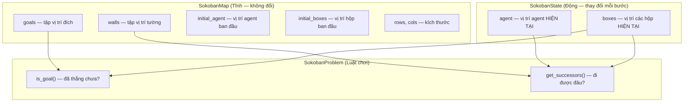
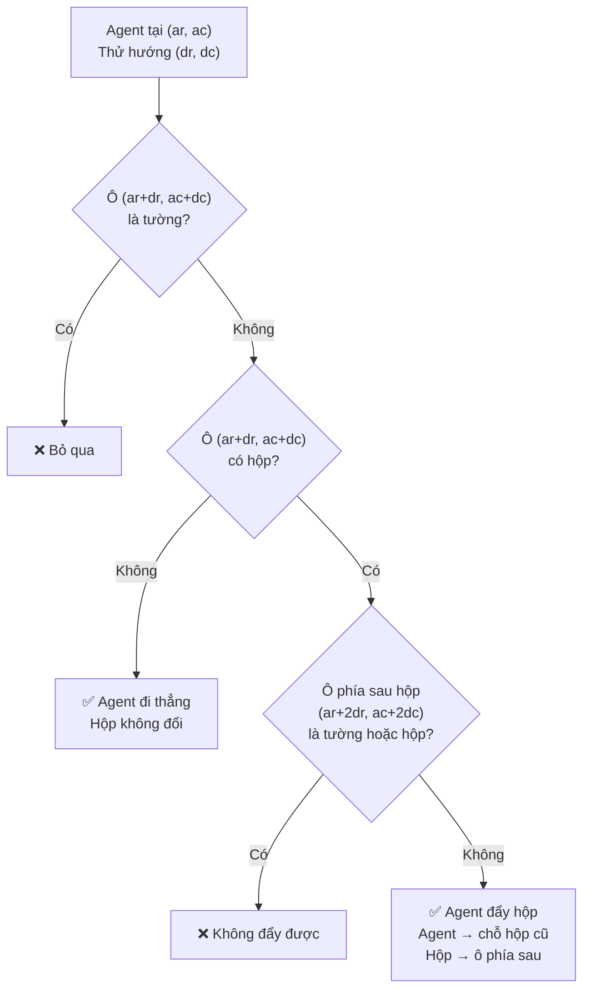
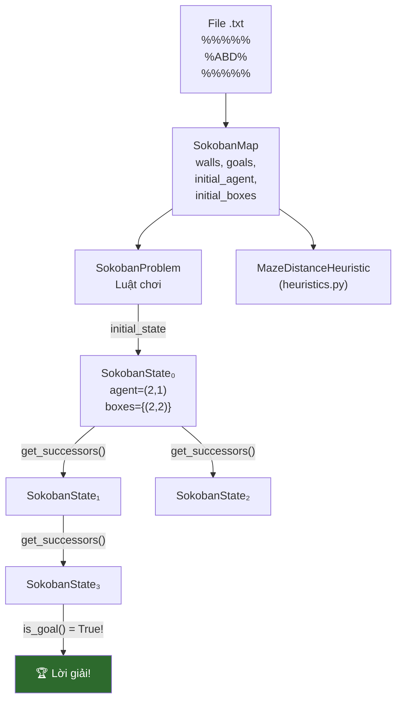

# Giải thích chi tiết: state.py

File [`state.py`](file:///e:/baitap/AI/MidTerm/state.py) là **nền tảng** của toàn bộ dự án. Nó định nghĩa:
1. **Bản đồ** trông như thế nào (`SokobanMap`)
2. **Trạng thái** game tại một thời điểm (`SokobanState`)
3. **Luật chơi** — agent đi được đâu, đẩy hộp ra sao (`SokobanProblem`)

---

## Tổng quan 3 class



**Tại sao tách Tĩnh và Động?**
- **Tường, đích** không bao giờ thay đổi → lưu 1 lần trong `SokobanMap`
- **Agent, hộp** thay đổi mỗi bước → tạo `SokobanState` mới mỗi bước
- Thuật toán tìm kiếm sinh ra **hàng triệu** `SokobanState` nhưng chỉ có **1** `SokobanMap` → tiết kiệm bộ nhớ

---

## Phần 1: Cấu hình UTF-8 (Dòng 1-8)

```python
import sys
from typing import Tuple, FrozenSet, List, Set, Optional

if sys.stdout.encoding != "utf-8":
    try:
        sys.stdout.reconfigure(encoding="utf-8")
    except Exception:
        pass
```

**Mục đích:** Đảm bảo console Windows hiển thị đúng tiếng Việt (ví dụ: thông báo lỗi). Nếu encoding không phải UTF-8, cố gắng chuyển sang UTF-8. Nếu thất bại (ví dụ trên Python cũ), bỏ qua.

---

## Phần 2: `SokobanMap` — Dữ liệu bản đồ tĩnh (Dòng 11-53)

### 2.1 Khởi tạo `__init__` (Dòng 14-23)

```python
class SokobanMap:
    """Chứa thông tin tĩnh của bản đồ (kích thước, tường, vị trí đích)."""

    def __init__(self, filepath: str):
        self.filepath = filepath                           # Đường dẫn file map
        self.walls: Set[Tuple[int, int]] = set()          # Tập vị trí tường
        self.goals: Set[Tuple[int, int]] = set()          # Tập vị trí đích
        self.initial_agent: Optional[Tuple[int, int]] = None  # Vị trí agent ban đầu
        self.initial_boxes: Set[Tuple[int, int]] = set()  # Tập vị trí hộp ban đầu
        self.rows = 0                                     # Số hàng
        self.cols = 0                                     # Số cột

        self._load_from_file(filepath)                    # Đọc file ngay khi tạo object
```

> [!NOTE]
> **`Set[Tuple[int, int]]` là gì?**
> - `Tuple[int, int]` = tọa độ `(hàng, cột)`, ví dụ `(2, 3)` = hàng 2, cột 3
> - `Set[...]` = tập hợp — không trùng lặp, tra cứu `in` rất nhanh O(1)
> - Ví dụ: `walls = {(0,0), (0,1), (0,2), (1,0), ...}` — tập tất cả ô tường

### 2.2 Đọc file bản đồ `_load_from_file` (Dòng 25-50)

```python
def _load_from_file(self, filepath: str) -> None:
    with open(filepath, "r", encoding="utf-8") as f:
        lines = [line.rstrip("\r\n") for line in f]   # Đọc tất cả dòng, bỏ ký tự xuống dòng
```

> [!NOTE]
> **`rstrip("\r\n")`** — Xóa ký tự xuống dòng ở cuối mỗi dòng:
> - `\n` = xuống dòng (Linux/Mac)
> - `\r\n` = xuống dòng (Windows)
> - Nếu không xóa, ký tự `\r` hoặc `\n` sẽ bị coi là ký tự trong bản đồ

**Dòng 29-30 — Tính kích thước bản đồ:**

```python
    self.rows = len(lines)                              # Số hàng = số dòng trong file
    self.cols = max(len(line) for line in lines) if lines else 0
    #          ↑ Số cột = dòng dài nhất (vì các dòng có thể không đều nhau)
```

**Ví dụ:**
```
%%%%%      ← len = 5
%   %      ← len = 5
%ABD%      ← len = 5
%   %      ← len = 5
%%%%%      ← len = 5

→ rows = 5, cols = max(5,5,5,5,5) = 5
```

**Dòng 32-47 — Duyệt từng ký tự và phân loại:**

```python
    for r, line in enumerate(lines):         # r = chỉ số hàng (0, 1, 2, ...)
        for c, ch in enumerate(line):        # c = chỉ số cột, ch = ký tự
```

**Bảng ký tự và xử lý:**

| Ký tự | Ý nghĩa | Code | Ví dụ |
|---|---|---|---|
| `%` | Tường | `self.walls.add((r, c))` | `walls = {(0,0), (0,1), ...}` |
| `D` | Đích (Goal) | `self.goals.add((r, c))` | `goals = {(3,3)}` |
| `A` | Agent (người chơi) | `self.initial_agent = (r, c)` | `initial_agent = (2,1)` |
| `B` | Hộp (Box) | `self.initial_boxes.add((r, c))` | `initial_boxes = {(2,2)}` |
| `C` | Hộp đã ở trên đích | `self.goals.add((r, c))` VÀ `self.initial_boxes.add((r, c))` | Cả goals VÀ boxes đều có `(r,c)` |
| ` ` (space) | Ô trống | `pass` — không làm gì | — |

> [!IMPORTANT]
> **Ký tự `C` đặc biệt:** Nó đại diện cho hộp **đã nằm sẵn trên đích** từ đầu. Vì vậy vị trí `C` được thêm vào **CẢ HAI** `goals` và `initial_boxes`. Điều này đảm bảo bản đồ ghi nhận đúng: vị trí đó vừa là đích vừa có hộp.

**Ví dụ đọc file `map/1.txt`:**

```
File:          Kết quả sau khi đọc:
%%%%%          walls = {(0,0),(0,1),(0,2),(0,3),(0,4),
%   %                   (1,0),(1,4),
%ABD%                   (2,0),(2,4),
%   %                   (3,0),(3,4),
%%%%%                   (4,0),(4,1),(4,2),(4,3),(4,4)}

               goals = {(2,3)}           ← D ở hàng 2, cột 3
               initial_agent = (2,1)     ← A ở hàng 2, cột 1
               initial_boxes = {(2,2)}   ← B ở hàng 2, cột 2
               rows = 5, cols = 5
```

**Dòng 49-50 — Kiểm tra hợp lệ:**

```python
    if self.initial_agent is None:
        raise ValueError(f"Không tìm thấy vị trí agent 'A' trong map: {filepath}")
```

Nếu file map không có ký tự `A` → lỗi ngay lập tức, tránh crash khó hiểu sau này.

### 2.3 Kiểm tra tường `is_wall` (Dòng 52-53)

```python
def is_wall(self, r: int, c: int) -> bool:
    return (r, c) in self.walls or r < 0 or r >= self.rows or c < 0 or c >= self.cols
```

**Trả về `True` nếu ô `(r, c)` là tường HOẶC nằm ngoài bản đồ.**

| Điều kiện | Ý nghĩa |
|---|---|
| `(r, c) in self.walls` | Ô là tường `%` |
| `r < 0` | Trên cùng bản đồ (ngoài biên) |
| `r >= self.rows` | Dưới cùng bản đồ |
| `c < 0` | Bên trái bản đồ |
| `c >= self.cols` | Bên phải bản đồ |

> [!TIP]
> **Gộp biên vào tường** giúp code gọn hơn. Thay vì kiểm tra biên riêng ở khắp nơi, chỉ cần gọi `is_wall()` — nó tự động xử lý cả tường lẫn biên.

**Ví dụ:**
```python
map.is_wall(0, 0)   # True  — ô (0,0) là tường %
map.is_wall(1, 1)   # False — ô (1,1) là khoảng trống
map.is_wall(-1, 0)  # True  — ngoài bản đồ (phía trên)
map.is_wall(5, 0)   # True  — ngoài bản đồ (phía dưới, rows=5)
```

---

## Phần 3: `SokobanState` — Trạng thái động (Dòng 56-75)

Đây là class quan trọng nhất cho thuật toán tìm kiếm. Mỗi `SokobanState` đại diện cho **một bức ảnh chụp** của game tại một thời điểm.

### 3.1 `__slots__` (Dòng 59)

```python
class SokobanState:
    __slots__ = ("agent", "boxes", "_hash")
```

**`__slots__` là gì?** Bình thường, mỗi object Python có một `__dict__` (dictionary) để lưu thuộc tính. `__slots__` nói Python: "Class này CHỈ CÓ 3 thuộc tính, KHÔNG CẦN `__dict__`."

| Không có `__slots__` | Có `__slots__` |
|---|---|
| Mỗi object tốn ~104 bytes (vì `__dict__`) | Mỗi object tốn ~64 bytes |
| Tra cứu thuộc tính chậm hơn | Tra cứu nhanh hơn |
| Có thể thêm thuộc tính mới bất kỳ lúc nào | Chỉ dùng được 3 thuộc tính đã khai báo |

> [!IMPORTANT]
> **Tại sao quan trọng?** Thuật toán tìm kiếm tạo ra **hàng triệu** `SokobanState`. Tiết kiệm 40 bytes/object × 1,000,000 object = **~40 MB bộ nhớ!**

### 3.2 `__init__` (Dòng 61-64)

```python
def __init__(self, agent: Tuple[int, int], boxes: FrozenSet[Tuple[int, int]]):
    self.agent = agent        # Ví dụ: (2, 3) — agent ở hàng 2, cột 3
    self.boxes = boxes        # Ví dụ: frozenset({(2,2), (3,5)}) — 2 hộp
    self._hash = hash((self.agent, self.boxes))   # Tính hash 1 lần duy nhất
```

**Tại sao `boxes` dùng `FrozenSet` thay vì `Set` hay `List`?**

```python
# Set thường (set) — KHÔNG hashable → KHÔNG dùng được trong dict/set
s = {(1,2), (3,4)}
hash(s)        # ❌ TypeError: unhashable type: 'set'

# FrozenSet — hashable → DÙNG ĐƯỢC trong dict/set
fs = frozenset({(1,2), (3,4)})
hash(fs)       # ✅ Trả về số nguyên

# List — KHÔNG hashable, CÓ THỨ TỰ (không cần trong Sokoban)
l = [(1,2), (3,4)]
hash(tuple(l)) # Phải convert → chậm hơn
```

> [!IMPORTANT]
> **Thuật toán tìm kiếm cần lưu `SokobanState` vào `dict` (`explored`) và kiểm tra `in`.**
> - `explored = {state1: 0, state2: 3, ...}` → `state` phải **hashable**
> - `state in explored` → cần `__hash__()` và `__eq__()`
> - `FrozenSet` là tập hợp **bất biến** (immutable) → hashable ✓
>
> **Thứ tự hộp KHÔNG quan trọng:** `{(1,2), (3,4)}` và `{(3,4), (1,2)}` là **cùng một trạng thái**. `FrozenSet` tự động xử lý điều này (set không quan tâm thứ tự).

**`self._hash = hash((self.agent, self.boxes))`** — Tính hash **một lần duy nhất** khi tạo object, lưu vào `_hash`. Sau này mỗi lần gọi `hash(state)` chỉ trả về giá trị đã tính sẵn → **O(1)** thay vì tính lại mỗi lần.

### 3.3 `__hash__` và `__eq__` (Dòng 66-72)

```python
def __hash__(self) -> int:
    return self._hash              # Trả về hash đã tính sẵn → cực nhanh O(1)

def __eq__(self, other: object) -> bool:
    if not isinstance(other, SokobanState):
        return False
    return self.agent == other.agent and self.boxes == other.boxes
```

**2 trạng thái BẰNG NHAU khi và chỉ khi:**
1. Agent ở **cùng vị trí** VÀ
2. Tất cả hộp ở **cùng vị trí**

**Ví dụ:**
```python
s1 = SokobanState((2,1), frozenset({(2,2), (3,5)}))
s2 = SokobanState((2,1), frozenset({(3,5), (2,2)}))  # Thứ tự khác
s3 = SokobanState((2,1), frozenset({(2,2), (4,5)}))  # Hộp ở vị trí khác

s1 == s2  # True  — cùng agent, cùng tập hộp (frozenset không quan tâm thứ tự)
s1 == s3  # False — hộp ở vị trí khác
```

> [!NOTE]
> **`__hash__` và `__eq__` được Python gọi tự động khi:**
> - `state in explored` → gọi `__hash__()` để tìm bucket, rồi `__eq__()` để so sánh
> - `explored[state] = g` → gọi `__hash__()` để lưu vào dict
> - `{state1, state2}` → gọi `__hash__()` để kiểm tra trùng

### 3.4 `__repr__` (Dòng 74-75)

```python
def __repr__(self) -> str:
    return f"SokobanState(agent={self.agent}, boxes={sorted(self.boxes)})"
```

Dùng để debug — khi `print(state)`, hiển thị dạng dễ đọc:
```
SokobanState(agent=(2, 1), boxes=[(2, 2), (3, 5)])
```

---

## Phần 4: `SokobanProblem` — Luật chơi và bài toán tìm kiếm (Dòng 78-158)

Class này định nghĩa **bài toán tìm kiếm chính thức** theo mô hình lý thuyết AI:

| Thành phần | Trong lý thuyết | Trong code |
|---|---|---|
| **Trạng thái ban đầu** | Initial State | `self.initial_state` |
| **Kiểm tra đích** | Goal Test | `is_goal(state)` |
| **Hàm kế thừa** | Successor Function | `get_successors(state)` |
| **Chi phí bước** | Step Cost | Luôn = 1 |

### 4.1 Hằng số hướng đi `ACTIONS` (Dòng 81-86)

```python
ACTIONS = {
    "North": (-1, 0),    # Đi lên: hàng giảm 1, cột không đổi
    "South": (1, 0),     # Đi xuống: hàng tăng 1, cột không đổi
    "West": (0, -1),     # Đi trái: hàng không đổi, cột giảm 1
    "East": (0, 1)       # Đi phải: hàng không đổi, cột tăng 1
}
```

**Hệ tọa độ:**
```
        Cột 0  Cột 1  Cột 2  Cột 3  Cột 4
Hàng 0:  %      %      %      %      %
Hàng 1:  %                            %       ↑ North (-1, 0)
Hàng 2:  %      A      B      D      %       ↓ South (+1, 0)
Hàng 3:  %                            %       ← West  (0, -1)
Hàng 4:  %      %      %      %      %       → East  (0, +1)
```

> [!NOTE]
> Hàng tăng xuống dưới (không phải lên trên) — đây là quy ước chuẩn trong lập trình game/ma trận.

### 4.2 Khởi tạo `__init__` (Dòng 88-93)

```python
def __init__(self, sokoban_map: SokobanMap):
    self.map = sokoban_map                    # Lưu tham chiếu bản đồ
    self.initial_state = SokobanState(
        agent=self.map.initial_agent,          # Vị trí agent ban đầu từ file
        boxes=frozenset(self.map.initial_boxes) # Vị trí hộp ban đầu → frozenset
    )
```

**`frozenset(self.map.initial_boxes)`** — Chuyển `set` (mutable) thành `frozenset` (immutable) để tạo `SokobanState` hashable.

### 4.3 Kiểm tra đích `is_goal` (Dòng 95-98)

```python
def is_goal(self, state: SokobanState) -> bool:
    return state.boxes.issubset(self.map.goals)
```

**`issubset`** kiểm tra: **mọi phần tử của `boxes` đều nằm trong `goals`**?

```python
# Ví dụ:
goals = {(1,3), (5,3)}          # 2 vị trí đích

boxes1 = frozenset({(1,3), (5,3)})   # 2 hộp đều ở đích
boxes1.issubset(goals)               # True ✅ → THẮNG!

boxes2 = frozenset({(1,3), (4,3)})   # 1 hộp ở đích, 1 hộp chưa
boxes2.issubset(goals)               # False ❌ → chưa thắng

boxes3 = frozenset({(2,2)})          # 1 hộp, chưa ở đích nào
boxes3.issubset(goals)               # False ❌
```

> [!TIP]
> **`issubset` thay vì `==`:** Nếu map có 3 đích nhưng chỉ 2 hộp, thì chỉ cần 2 hộp ở 2 đích bất kỳ (trong 3 đích) là thắng. `issubset` xử lý đúng trường hợp này, `==` thì không.

### 4.4 Hàm kế thừa `get_successors` (Dòng 100-136) ⭐

Đây là **trái tim** của luật chơi Sokoban. Hàm này trả lời: **"Từ trạng thái hiện tại, agent có thể đi đâu?"**

```python
def get_successors(self, state: SokobanState) -> List[Tuple[str, SokobanState, int]]:
    successors: List[Tuple[str, SokobanState, int]] = []   # Danh sách kết quả
    ar, ac = state.agent                                    # Vị trí agent hiện tại
```

**Dòng 108 — Thử lần lượt 4 hướng:**

```python
    for action_name, (dr, dc) in self.ACTIONS.items():
        # action_name = "North", (dr, dc) = (-1, 0)
        new_ar, new_ac = ar + dr, ac + dc    # Vị trí agent MỚI nếu đi hướng này
```

#### Trường hợp 1: Đi vào tường → BỎ QUA (Dòng 111-113)

```python
        if self.map.is_wall(new_ar, new_ac):
            continue     # Không thể đi vào tường → bỏ qua hướng này
```

```
%%%%%
% A%%      Agent muốn đi East → (2,3) = tường %
%  %%      → is_wall(2,3) = True → continue
%%%%%
```

#### Trường hợp 2: Đẩy hộp (Dòng 115-129) ⭐

```python
        if (new_ar, new_ac) in state.boxes:       # Ô kế tiếp CÓ HỘP
            new_br, new_bc = new_ar + dr, new_ac + dc   # Vị trí hộp SAU KHI bị đẩy
```

**Hộp bị đẩy cùng hướng agent đi, 1 ô:**

```
Trước đẩy:       Sau đẩy (East):
  A B  □            □ A B
  ↑ ↑  ↑            ↑ ↑ ↑
agent hộp ô trống  ô trống agent hộp(mới)
```

**Dòng 119-121 — Kiểm tra hộp có thể bị đẩy không:**

```python
            if self.map.is_wall(new_br, new_bc) or (new_br, new_bc) in state.boxes:
                continue   # Hộp KHÔNG THỂ bị đẩy vào tường hoặc vào hộp khác
```

**2 trường hợp không đẩy được:**

```
Trường hợp 2a: Hộp bị đẩy vào TƯỜNG
  A B %     Agent đẩy East → hộp đi vào % → KHÔNG ĐƯỢC!
  
Trường hợp 2b: Hộp bị đẩy vào HỘP KHÁC
  A B B     Agent đẩy East → hộp 1 đi vào hộp 2 → KHÔNG ĐƯỢC!
            (Sokoban chỉ cho đẩy 1 hộp, không đẩy 2 hộp cùng lúc)
```

**Dòng 123-129 — Tạo trạng thái mới sau khi đẩy hộp:**

```python
            # Tạo tập vị trí hộp MỚI
            new_boxes = set(state.boxes)            # Copy tập hộp hiện tại (chuyển sang set mutable)
            new_boxes.remove((new_ar, new_ac))      # XÓA hộp ở vị trí cũ
            new_boxes.add((new_br, new_bc))         # THÊM hộp ở vị trí mới

            next_state = SokobanState(
                (new_ar, new_ac),                   # Agent di chuyển đến chỗ hộp cũ đứng
                frozenset(new_boxes)                # Tập hộp mới (convert lại frozenset)
            )
            successors.append((action_name, next_state, 1))   # Chi phí = 1
```

**Ví dụ minh họa đẩy hộp:**

```
Trước:                          Sau khi đẩy East:
%%%%%                           %%%%%
%   %                           %   %
%AB %  agent=(2,1), box=(2,2)  % AB%  agent=(2,2), box=(2,3)
%   %                           %   %
%%%%%                           %%%%%

Code thực hiện:
  new_ar, new_ac = 2, 2     ← vị trí agent mới = vị trí hộp cũ
  new_br, new_bc = 2, 3     ← vị trí hộp mới = hộp cũ + hướng đi
  new_boxes = {(2,2)}       ← copy
  new_boxes.remove((2,2))   ← xóa hộp vị trí cũ → {}
  new_boxes.add((2,3))      ← thêm hộp vị trí mới → {(2,3)}
  next_state = SokobanState((2,2), frozenset({(2,3)}))
```

#### Trường hợp 3: Đi vào ô trống (Dòng 131-134)

```python
        else:
            # Ô kế tiếp không có tường, không có hộp → agent đi bình thường
            next_state = SokobanState((new_ar, new_ac), state.boxes)
            #                        ↑ agent di chuyển    ↑ hộp KHÔNG ĐỔI
            successors.append((action_name, next_state, 1))
```

> [!NOTE]
> Khi agent chỉ đi (không đẩy hộp), `state.boxes` được **tái sử dụng** trực tiếp (không copy). Vì `frozenset` là immutable, nhiều `SokobanState` có thể **chia sẻ cùng object `boxes`** → tiết kiệm bộ nhớ.

### Tổng hợp 3 trường hợp bằng sơ đồ:



### Ví dụ đầy đủ `get_successors`:

```
Trạng thái: Agent=(2,2), Boxes={(2,3), (3,2)}

%%%%%%%
% A   %       Thử 4 hướng:
% %%  %
%   B %       North: (1,2) → trống ✅ → agent=(1,2), boxes giữ nguyên
%   D %       South: (3,2) → có hộp! → phía sau (4,2) trống ✅
%%%%%%%                      → agent=(3,2), boxes={(2,3),(4,2)}
              West: (2,1) → trống ✅ → agent=(2,1), boxes giữ nguyên
              East: (2,3) → có hộp! → phía sau (2,4) = %% = tường ❌

Kết quả: 3 successors:
  [("North", State(agent=(1,2), boxes={(2,3),(3,2)}), 1),
   ("South", State(agent=(3,2), boxes={(2,3),(4,2)}), 1),
   ("West",  State(agent=(2,1), boxes={(2,3),(3,2)}), 1)]
```

### 4.5 In trạng thái `to_string` (Dòng 138-158)

```python
def to_string(self, state: SokobanState) -> str:
    output_rows = []
    for r in range(self.map.rows):
        chars = []
        for c in range(self.map.cols):
            pos = (r, c)
            if pos in self.map.walls:                             # Ưu tiên 1: Tường
                chars.append("%")
            elif pos == state.agent:                              # Ưu tiên 2: Agent
                chars.append("A")
            elif pos in state.boxes and pos in self.map.goals:    # Ưu tiên 3: Hộp trên đích
                chars.append("C")
            elif pos in state.boxes:                              # Ưu tiên 4: Hộp
                chars.append("B")
            elif pos in self.map.goals:                           # Ưu tiên 5: Đích trống
                chars.append("D")
            else:                                                 # Ưu tiên 6: Ô trống
                chars.append(" ")
        output_rows.append("".join(chars))
    return "\n".join(output_rows)
```

**Thứ tự ưu tiên quan trọng:**
- Nếu hộp ở trên đích → hiển thị `C` (không phải `B` hoặc `D`)
- Agent luôn hiển thị `A` (kể cả khi đứng trên đích)

**Ví dụ:**
```python
problem.to_string(state)
# Trả về:
# %%%%%
# %   %
# % AB%    ← B ở (2,3) nhưng nếu (2,3) cũng là goal → hiển thị C
# %  D%
# %%%%%
```

---

## Tóm tắt mối quan hệ giữa 3 class



| Class | Vai trò | Số lượng object |
|---|---|---|
| `SokobanMap` | Dữ liệu tĩnh (tường, đích) | **1** cho mỗi map |
| `SokobanProblem` | Luật chơi (successors, goal test) | **1** cho mỗi lần giải |
| `SokobanState` | Trạng thái tại 1 thời điểm | **Hàng triệu** (sinh bởi thuật toán) |
